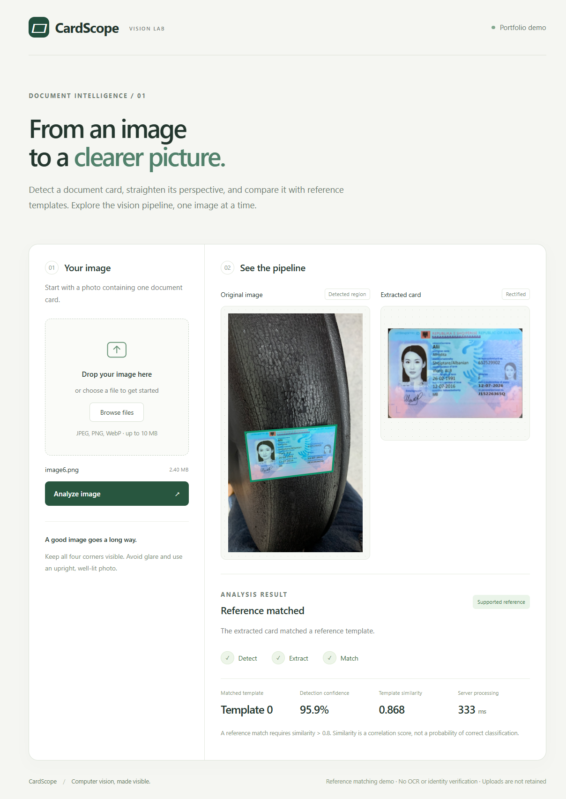

# CardScope · Document vision lab

CardScope detects a card in a photograph, corrects its perspective, and compares
it with reference images. Built as an AI / Computer Vision Engineer portfolio project.



## Features

- Upload a JPEG, PNG, or still WebP image.
- View the detected card boundary and the extracted, rectified card.
- Compare the card against ten reference templates, with faces masked for matching.
- Inspect detection confidence, template similarity, and unsuccessful outcomes.

## How it works

```text
Upload → card detection → perspective correction → reference matching → results
```

YOLO detects the card, and OpenCV handles extraction and template matching.
A FastAPI backend serves the analysis to a React + TypeScript interface.

## Quick start

Install Docker with Compose and start Docker Desktop on Windows/macOS. Ensure
these model weights and reference images are present:

```text
training/model/yolov8s-detect.pt
training/model/yolov8n-face.pt
training/template_samples/Template 0.jpg … Template 9.jpg
```

From the repository root:

```sh
docker compose up --build
```

Open the application at http://localhost:8080. Interactive API documentation is
available at http://localhost:8000/docs.

The first build downloads dependencies and may take several minutes. The Docker
setup runs inference on CPU and uses amd64 emulation on ARM hosts.

To stop the application:

```sh
docker compose down
```

## Local installation

Use Python 3.12 and Node 22 or a newer supported LTS release, with the model and
reference files listed above. Start the backend from the repository root:

**Windows (PowerShell)**

```powershell
python -m venv .venv
.\.venv\Scripts\python.exe -m pip install -r backend/requirements-dev.txt
.\.venv\Scripts\python.exe -m uvicorn backend.app.main:app --port 8000
```

**Linux/macOS**

```sh
python3.12 -m venv .venv
.venv/bin/python -m pip install --no-deps -c backend/constraints.txt torch torchvision --index-url https://download.pytorch.org/whl/cpu
.venv/bin/python -m pip install -r backend/requirements-dev.txt
.venv/bin/python -m uvicorn backend.app.main:app --port 8000
```

In another terminal, start the frontend from the repository root:

```sh
cd frontend
npm ci
npm run dev
```

Open http://localhost:5173. If PowerShell blocks `npm.ps1`, use `npm.cmd`.
For full setup instructions, configuration, and testing, see the
[development guide](docs/development.md).

## Limitations

- This demo matches reference images; it does not verify identity, authenticate
  documents, or perform OCR.
- Only the first detected card is processed. Lighting, orientation, and alignment
  affect matching; border refinement can fail or clip card content.
- Similarity scores are not probabilities. The matching threshold has not been
  validated on a labeled evaluation set, and sample results do not establish accuracy.
- References were collected online. Document names and redistribution permissions
  have not been verified; check the source assets before publishing a public demo.

## Documentation

- [Development and testing](docs/development.md)
- [API reference](docs/api.md)
- [Inference details and sample observations](docs/inference.md)
- [Dataset preparation and training](training/README.md)
